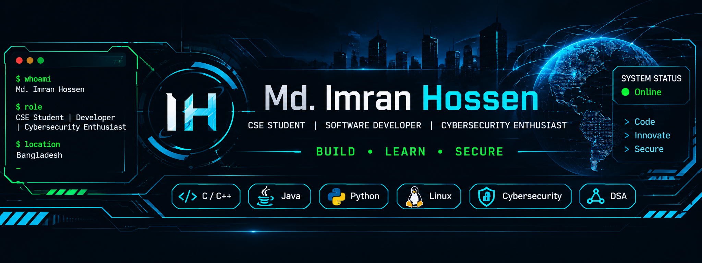

# Md. Imran Hossen

### CSE Student | Programmer | Cybersecurity Enthusiast

**BUILD • LEARN • SECURE**

---

## 01. About Me

I'm a Computer Science and Engineering student at **Green University of Bangladesh**, interested in programming, software development, and cybersecurity.

- 🎓 B.Sc. in Computer Science & Engineering
- 💻 Programming with C, C++, and Java
- 🐧 Learning Linux administration and networking
- 🔐 Exploring cybersecurity and web application security
- 🧠 Practicing Data Structures and Algorithms

## 02. Technical Arsenal

| Category | Technologies |
|---|---|
| Programming | C, C++, Java |
| Learning | Python, JavaScript |
| Web | HTML, CSS |
| Database | MySQL, SQL |
| Operating Systems | Linux, Kali Linux, Ubuntu Server |
| Development Tools | Git, GitHub, VS Code, NetBeans |
| Virtualization | VMware Workstation |
| Embedded Systems | Arduino Uno |

## 03. Featured Projects

### 1. Graph Algorithm Visualizer
**C | Data Structures & Algorithms**

- Prim's and Kruskal's Minimum Spanning Tree algorithms
- Dijkstra's shortest-path algorithm
- Weighted graph representation
- Disjoint Set Union (DSU)

### 2. Smart Cafeteria Management System
**Java | OOP | Java Swing | MySQL | JDBC**

[View Repository](https://github.com/ihkabbo/smart-cafeteria-management-system)

- Student and administrator interfaces
- Login and registration system
- Food menu and category management
- Shopping cart and order management
- Payment and stock management
- MySQL database integration

### 3. Cafeteria Management System
**C | Data Structures | File Handling**

[View Repository](https://github.com/ihkabbo/cafeteria-management-system-c)

- Console-based cafeteria management
- Food menu management
- Linked list implementation
- Quantity and price management
- Order processing
- File handling for data storage

### 4. Smart Home Security System
**Arduino | Embedded Systems**

[View Repository](https://github.com/ihkabbo/smart-home-security-system)

- Keypad password authentication
- LCD interface
- Servo-based locking mechanism
- Alarm after three incorrect attempts
- EEPROM password storage

### 5. Smart Street Lighting System
**Arduino | LDR Sensor | Embedded Systems**

[View Repository](https://github.com/ihkabbo/smart-street-lighting-system)

- Automatic light detection
- LED control based on ambient light
- Manual button functionality
- LCD monitoring

### 6. Student Test Result Grading System
**C | Programming Fundamentals**

[View Repository](https://github.com/ihkabbo/student-grading-system)

- Multiple student result management
- Subject-wise mark calculation
- Automatic letter grade assignment
- Input validation
- Overall result generation

### 7. Cybersecurity Practice Lab
**Kali Linux | Ubuntu Server | VMware**

[View Repository](https://github.com/ihkabbo/cybersecurity-practice-lab)

- Virtual Linux environments
- Linux command-line practice
- Basic networking exercises
- Cybersecurity fundamentals

### 8. Developer Portfolio
**GitHub | Markdown | GitHub Actions**

[View Repository](https://github.com/ihkabbo/ihkabbo)

- Personal developer profile
- Project documentation
- Technical skills and learning journey
- GitHub profile customization

## 04. Leadership & Activities

- **Organising Secretary** — MODERN JURASSIC PARK CENTRAL STUDENT'S UNION (MJPCSU)
- **Senior Patrol Leader** — Bangladesh Scouts
- **OOP Lab Class Representative**

## 05. Achievements & Participation

- 11th Place — IEEE Olympiad GUB 2025, Junior Level
- Appreciation — IEEE Student Branch
- Participant — GUBCPC July Memorial Programming Contest 2026
- Volunteer — Dowraw Bangladesh 10 KM Marathon
- Participant — IEEE Day 2025
- Participant — IEEE Young Professionals Bangladesh Talk Series 2025

## 06. Current Focus

- Data Structures and Algorithms
- C/C++ and Java programming
- Linux administration and networking
- Web application security
- Python programming
- Software development

## 07. Connect With Me

**BUILD • LEARN • SECURE**

*Building skills through practice, projects, and continuous learning.*

## 08. GitHub Contribution Activity

### 🐍 Watch my contributions

---

## 09. GitHub Analytics

  

---

